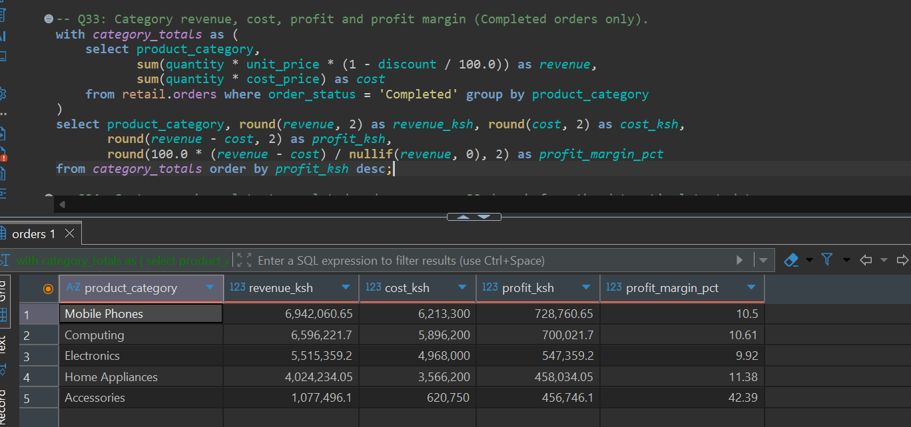
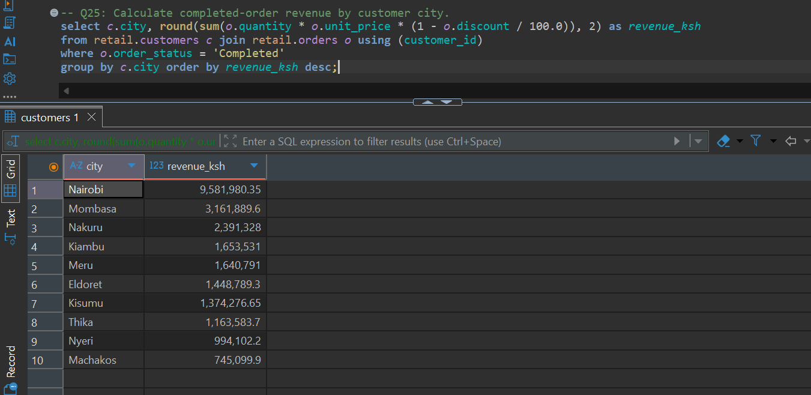
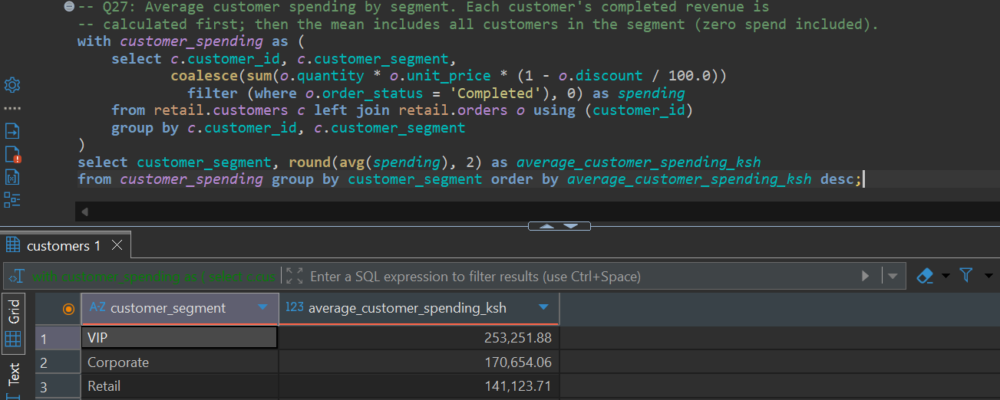
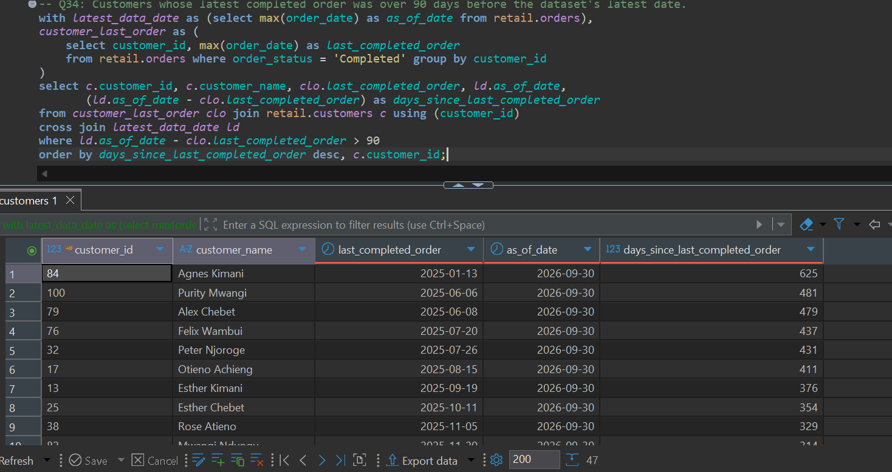
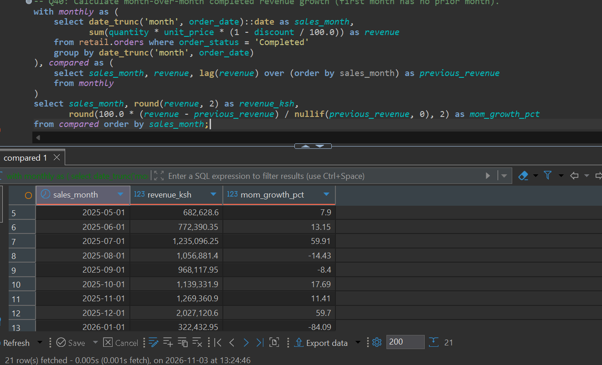
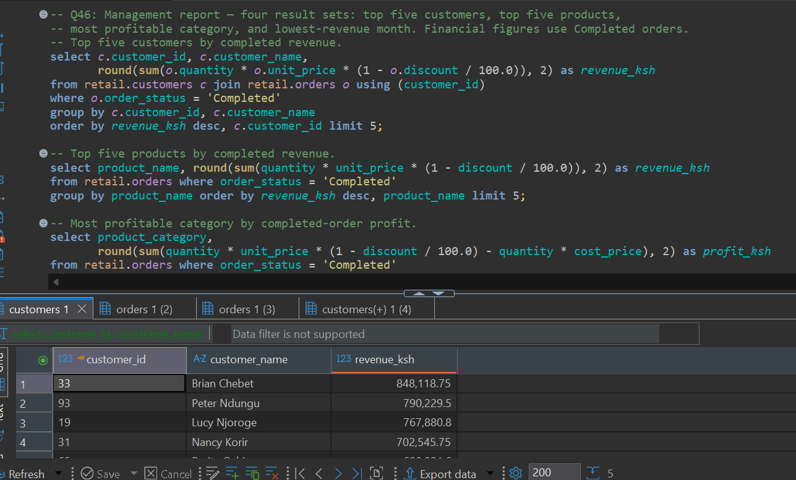

# Business insights and recommendations

The findings below use the supplied dataset and the results from Q16, Q25, Q27, Q33, Q34, Q40, and Q46. All revenue, spending, and profit figures are in KSh and use completed orders only.

## 1. Accessories have the strongest margin, while mobile phones generate the most profit

**Evidence (Q33):** Accessories generated KSh 1,077,496.10 in revenue and KSh 456,746.10 in profit, for a 42.39% margin. Mobile Phones generated the most profit at KSh 728,760.65 from KSh 6,942,060.65 revenue, with a 10.50% margin. Home Appliances had the next-highest margin at 11.38%.

**Why it matters:** Revenue leadership and margin leadership are different. Accessories contribute much less revenue than the largest categories but convert a larger share of revenue into profit.

**Recommendation:** Protect accessory availability and review whether accessories can be bundled with phone or computer purchases. Track bundle margin and accessory attachment rate so growth does not depend on unnecessary discounting.

## 2. Nairobi is the largest sales market by a wide margin

**Evidence (Q25):** Nairobi produced KSh 9,581,980.35 in completed revenue. Mombasa, the next-highest city, produced KSh 3,161,889.60. Machakos was lowest at KSh 745,099.90.

**Why it matters:** Sales are concentrated geographically. Nairobi is a major revenue base, while lower-revenue cities may represent either smaller markets or an opportunity that needs more investigation.

**Recommendation:** Maintain product availability and service capacity in Nairobi. Before investing in broad campaigns in lower-revenue cities, compare their customer counts, order frequency, product availability, and average order value to determine whether the gap reflects demand or an execution issue.

## 3. VIP customers have the highest average spending

**Evidence (Q27):** Average completed spending per customer was KSh 253,251.88 for VIP, KSh 170,654.06 for Corporate, and KSh 141,123.71 for Retail customers.

**Why it matters:** VIP customers spend more on average in this dataset, which makes retention and service quality important to protecting revenue.

**Recommendation:** Offer VIP customers useful service benefits, such as priority support or product setup, and measure repeat purchases and profitability. Compare the cost of each benefit with the additional completed revenue it generates.

## 4. Forty-seven customers appear at risk of becoming inactive

**Evidence (Q34):** The query returned 47 customers whose latest completed order was more than 90 days before the dataset's latest order date, 30 September 2026. The longest gap was 625 days.

**Why it matters:** A substantial group has not made a recent completed purchase. The oldest gaps suggest some may no longer be active, while more recent gaps may be recoverable.

**Recommendation:** Prioritize outreach using both recency and historical customer value. Start with high-value customers who have been inactive for 90–180 days, test a relevant message or offer, and compare reactivation and margin against a group that receives no offer. Avoid sending the same discount to every inactive customer.

## 5. Monthly revenue is growing overall but has sharp swings

**Evidence (Q40):** Revenue reached KSh 2,027,120.60 in December 2025, then fell 84.09% to KSh 322,432.95 in January 2026, the lowest month in Q46. It later rose to KSh 2,242,033.90 in August 2026, then decreased 6.67% to KSh 2,092,445.15 in September.

**Why it matters:** Large month-to-month changes make purchasing, staffing, and cash planning harder. The data shows when the changes happened but does not explain their causes.

**Recommendation:** Investigate the December-to-January decline by comparing order counts, average order value, category mix, and status counts. Check whether it reflects seasonality, stock availability, or incomplete data before changing the sales plan. Use the observed monthly pattern to improve forecasts once the cause is understood.

## 6. The leading products and customers are concentrated at the top

**Evidence (Q46):** The highest-revenue customer, Brian Chebet, generated KSh 848,118.75. The top product, iPhone 13, generated KSh 3,766,458.15; the next product, HP 250 G9 Laptop, generated KSh 2,510,510.15.

**Why it matters:** A small number of customers and products can have an outsized effect on results. Losing a major buyer or running out of a leading product could materially affect sales.

**Recommendation:** Monitor repeat purchase behavior for top customers and keep reliable stock coverage for top products. Review product profit and supplier lead times before expanding inventory, and build sales around complementary products to reduce reliance on a single item.

## Caveat

These are descriptive results from fictional assignment data. They identify patterns and useful follow-up questions; they do not establish why a pattern occurred. Validate causes with operational information such as stockouts, campaign dates, returns, and customer contact history before making major changes.
